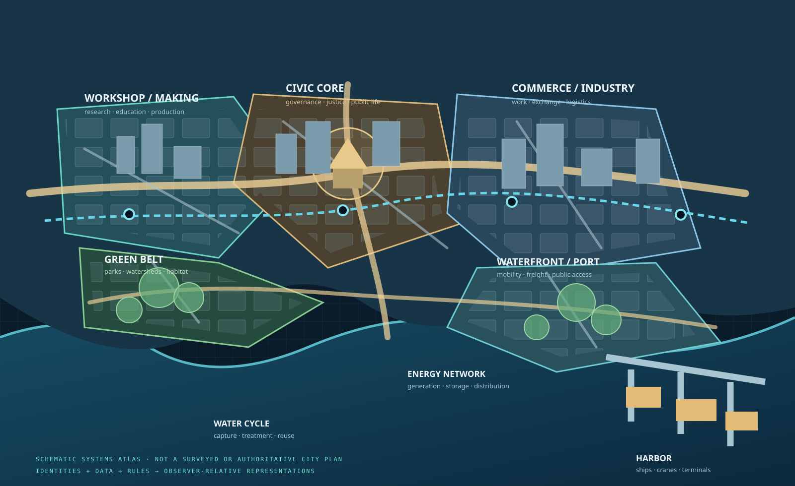

# The Singularity Workshop — Singularity City

**Singularity City is the persistent, navigable spatial front door to The Singularity Workshop.** It connects places, people, civic systems and independently owned experiences into one discoverable world.

> A city is more than a place on a map. It is a living index of what exists, what can happen here, and where you can go next.

The atlas is a conceptual systems illustration; the browser proof and Visualize's CPU/SVG city-massing proof are separate, explicitly labelled implementation paths.

## Preview status

The development Pages workflow now passes static validation, assembles the public site, uploads the Pages artifact, and completes the Configure Pages step. The deploy job is blocked before any executable deployment step or log is exposed. This points to a `github-pages` environment approval or deployment-branch protection rule, which the connected GitHub controls do not expose. A successful deployment is therefore not claimed. Please open the latest City Pages Actions run and approve its pending `deploy` job if GitHub is requesting environment approval; otherwise allow `development` in Settings → Environments → `github-pages` → Deployment branches and tags. Keep `master` release-aligned. The City Pages workflow now checks out Visualize `development`, validates the Renderer/FSM policy matrix and browser module, and packages the complete WebGPU lab locally under `visualization-lab/` with its exact source revision. The City preview therefore does not depend on Visualize's separate Pages deployment. The preview URLs are retained for verification:

- **Explore:** [Singularity City](https://trentbest.github.io/TheSingularityWorkshop.SingularityCity/)
- [Current field notes](https://trentbest.github.io/TheSingularityWorkshop.SingularityCity/thinking.html)
- Proposed handoff to an experience such as [FSM_Dungeon](https://github.com/TrentBest/FSM_Dungeon).

The browser proof is a static, interactive navigation fixture. It does not claim live persistence, multiplayer, authoritative simulation or a connected dungeon runtime.

## Dwarven visitors and neighboring strongholds

A town near a dwarven stronghold can have a visible dwarven presence in its market without loading or exposing the stronghold itself. City owns the market, stalls, residents, visitors, schedules, institutions, trade locations, and resident-place relationships. The general [SURPS Dwarves sourcebook, LOD 1](https://github.com/TrentBest/TheSingularityWorkshop.SingularityUniversalRolePlayingSystem/blob/development/docs/books/dwarves.md) supplies cultural and encounter context. The stronghold remains a separate higher-detail destination; entering it invokes the [Dwarven Strongholds sourcebook, LOD 2](https://github.com/TrentBest/TheSingularityWorkshop.SingularityUniversalRolePlayingSystem/blob/development/docs/books/dwarven-mountain-fortress.md) and FSM_Dungeon's underground environment. City may represent a known neighboring stronghold as a destination reference without owning its interior.

## What City owns

- Persistent geography, districts, parcels, places and routes.
- Ownership, zoning, construction and civic institutions.
- Residents (Digitens), visitors, communities, occupations, and their city-level relationships.
- City-level NPC identity, daily life, schedules, population representation, and resident-place relationships.

The general [Nonplayer Characters sourcebook (LOD 1)](docs/books/nonplayer-characters.md) is the canonical City-owned people-and-agency domain. Specialist repositories extend it at higher LOD without redefining character identity; for example, [Laboratory NPCs (LOD 2)](https://github.com/TrentBest/TheSingularityWorkshop.SingularityLaboratories/blob/development/docs/books/laboratory-npcs.md).
- City economy, services, discoverability and access decisions.
- Spatial entry points into independently owned experiences.

## What City does not own

City does not absorb the simulation of every destination. The Underworks entrance can resolve to `TrentBest/FSM_Dungeon`; the dungeon repository owns its topology, inhabitants and underground simulation. Workshop tools, laboratories, games and shipyards remain reusable domain capabilities composed through MicroBundles.

**Physics owns terrain generation and physical evolution.** City consumes Physics-produced terrain datasets and builds civic geography around them; the current synthetic terrain file is only a labelled presentation fixture. See [Physics terrain and worldbuilding](docs/PHYSICS_TERRAIN_AND_WORLDBUILDING.md).

## Architecture

`Workshop → Singularity Transit → Singularity City → World`

`Ontology → MicroBundles → arbitration → Experience → spatial manifestation`

- [Architecture and responsibility boundaries](docs/ARCHITECTURE.md)
- [WebPage host integration](docs/WEBPAGE_HOST_INTEGRATION.md) — City-owned contracts, extraction inventory, spatial requirements, and the browser-host proof sequence.
- [Human proof review and verification](docs/PROOF_REVIEW_AND_VERIFICATION.md) — proof claims, automated evidence, human review checkboxes and the boundary between local notes and shared certification.
- [Singularity Mall pavilion](docs/SINGULARITY_MALL_PAVILION.md) — pavilion spaces, merchant boundaries, and the interactive browser experience.
- [Mall management and tenant design](docs/MALL_MANAGEMENT_AND_TENANT_DESIGN.md) — management office, vacant units, tenant facade/interior customization, and the boundary between local drafts and future shared leasing.
- [Visitor characters and the first explorable world](docs/VISITOR_CHARACTERS_AND_EXPLORATION.md) — portable character creation/import/export, compatibility, and the first inhabited destination.\n- [Entangled realities and digital real estate](docs/ENTANGLED_REALITIES.md) — proposed company tenancy, shared workplace Experiences, cross-device co-entanglement and immersive BIM coordination, with explicit implementation gaps.
- [Markets, venues and creator commerce](docs/MARKETS_VENUES_AND_CREATOR_COMMERCE.md) — City markets, concert/convention venues, low-friction creator shops and the integration boundary with Economy.
- [Physics terrain and worldbuilding](docs/PHYSICS_TERRAIN_AND_WORLDBUILDING.md) — Physics-owned terrain authority, existing APIs, adapter contract and worldbuilding sequence.
- [Maps as city data](docs/MAPS_AS_CITY_DATA.md) — terrain-first spatial layers, hydrology, planning maps and provenance.
- [Historical cartography and city history](docs/HISTORICAL_CARTOGRAPHY_AND_CITY_HISTORY.md) — period maps, source evidence, temporal features, uncertainty and the city's changing story.
- [City builder and first-person mayor experience](docs/CITY_BUILDER_AND_FIRST_PERSON_EXPERIENCE.md) — shared map/world contract and playable progression.
- [City spatial and civic model](docs/CITY_MODEL.md)
- [Commerce route fixture: itinerant peddler](docs/COMMERCE_ROUTE_FIXTURE.md) — first authored people, inventory, conveyance, route and visit relationship proof.
- [Greenhollow NPC generation](docs/GREENHOLLOW_NPC_GENERATION.md) — deterministic shopkeeper, customer and visitor candidate suggestions, pending SURPS identity binding.
- [Economy in Singularity City](docs/ECONOMY_IN_SINGULARITY_CITY.md) — Economy package boundary, a deterministic City Marks ledger fixture, and the path toward a living Digiten economy.
- [Vehicles, mobility and transport](docs/books/vehicles.md) — capability-based vehicle definitions, fleets, journeys and Physics/Economy ownership.
- [Buildings, materials and construction](docs/books/buildings-and-construction.md) — material/tool/skill capability profiles and construction feasibility.
- [Thieves & Shadow Work (LOD 2)](docs/books/thieves-and-shadow-work.md) — character specialization for thieves, from motives and relationships to allegations, consequences and reform.
- [The Urban Underworld (LOD 2)](docs/books/urban-underworld.md) — crews, fences, black markets, disputed property, corruption and hidden civic power.
- [Law Enforcement & Public Safety (LOD 2)](docs/books/law-enforcement-and-public-safety.md) — public-safety institutions, jurisdiction, evidence, response, oversight and trust.
- [Justice, Courts & Restitution (LOD 2)](docs/books/justice-courts-and-restitution.md) — due process, evidence, findings, remedies, appeals and repair.
- [Governance & Civic Administration (LOD 2)](docs/books/governance-and-civic-administration.md) — institutions, public offices, jurisdiction, service delivery, budgets and accountability.
- [Politics, Power & Public Will (LOD 2)](docs/books/politics-power-and-public-will.md) — elections, factions, coalitions, dissent, legitimacy and transfers of power.
- [Elections & Player Participation (LOD 2)](docs/books/elections-and-player-participation.md) — player voting, constitutional election rules, campaign finance, secret ballots, candidate advertisements and recounts.
- [Civic process model](docs/CIVIC_PROCESS_MODEL.md) — versioned proposal, deliberation, decision, authorization, oversight, impact and appeal boundaries.
- [Greenhollow civic stress test](docs/GREENHOLLOW_CIVIC_STRESS_TEST.md) — integrated fictional sequence linking rumor, evidence, vigilantism, public safety, justice, civic response and the existing election fixture.
- [Vigilantes & Civic Justice (LOD 2)](docs/books/vigilantes-and-civic-justice.md) — self-appointed protectors, masked identities, community response, accountability and the boundary between aid and private enforcement.
- [Villains & Antagonists (LOD 2)](docs/books/villains-and-antagonists.md) — antagonists with motives, capabilities, factions, public narratives, agency and consequences.
- [SURPS vehicle rulebook specification](docs/rulebooks/SurpsRulebookVehiclesAndMobility.md) and [building/construction rulebook specification](docs/rulebooks/SurpsRulebookBuildingsAndConstruction.md) — content-first rulebooks pending the shared SURPS interface.
- [Declarative experience entry points](docs/EXPERIENCES.md)
- [Build your own city, step by step](docs/BUILD_YOUR_CITY.md)
- [Source-grounded world research and evidence ledger](docs/SOURCE_RESEARCH.md)
- [Living picture: visual architecture and proof ladder](docs/LIVING_PICTURE.md · [Greenhollow living-scene manifest](docs/GREENHOLLOW_LIVING_SCENE.md) · [Pages Build and Deployment](docs/PAGES_BUILD_AND_DEPLOYMENT.md)) — now includes the first [ambient Greenhollow SVG map study](assets/images/greenhollow-living-map-study.svg) with river flow, road travelers, a peddler, shopkeeper and customers.
- [City experience channels](docs/CITY_EXPERIENCE_CHANNELS.md) — independently experience the same city through Visualization, Renderer, or both, with the first opt-in audio proof and its limits.
- [Civic Quarter connected district proof](docs/CIVIC_QUARTER_VERTICAL_SLICE.md)
- [Civil systems and city theory atlas](docs/CIVIL_SYSTEMS_AND_CITY_THEORY.md)
- [Wheel of Time city showcase plan](docs/WHEEL_OF_TIME_SHOWCASE.md)
- [City sourcebooks](docs/books/README.md)
- [SURPS sourcebook catalogue](docs/books/index.md) and [participation manifest](.surps/participation.json) — ten descriptor-backed draft City books are declared for SURPS review; the repository remains integrated-not-enrolled pending independent registry review in [SURPS issue #1](https://github.com/TrentBest/TheSingularityWorkshop.SingularityUniversalRoleplayingSystem/issues/6).
- [Place-specific city sourcebook program](docs/CITY_SOURCEBOOKS.md) — books about cities, ancient settlements, archaeological sites and cultural landscapes, with evidence, visual atlases and an educational path into interactive learning.
- [Reality sets, place identity and historical reconstruction](docs/REALITY_AND_RECONSTRUCTION.md) — the shared-ontology boundary between real places, evidence-based reconstructions, fictional realities and “based on” inspirations; includes a scan-first path toward walkable archaeological experiences.
- [Göbekli Tepe research pilot](docs/books/places/gobekli-tepe/README.md) — initial source ledger and a plan to pursue authoritative present-day LiDAR/3D survey data before building a historical reconstruction.
- [Workshop documentation standard](https://github.com/TrentBest/TheSingularityWorkshop.FSM_COS/blob/master/DOCUMENTATION_STANDARD.md) — shared reader journey, evidence labels, provenance, diagrams, CI gates and README policy.
- [CiAi City evidence-consumer request](https://github.com/TrentBest/TheSingularityWorkshop.CiAi/issues/86) — read-only exact-commit CI observation; GitHub Actions remains authoritative.

## Development

- Active work: `development`
- Release-aligned branch: `master`
- GitHub Pages workflow: `.github/workflows/pages.yml`
- No NuGet package is published by this repository workflow.

The current implementation includes a terrain-first layered map stack with sampled elevation, marching-squares contours, land cover, watersheds, district and parcel maps, mobility, transit, utilities and hazard screening. It also includes a 13-domain systems catalog and a connected synthetic Civic Quarter proof spanning parcels, buildings, rooms, public space and civic services. The map stack and district workbench are generated from shared models with stable IDs and explicit provenance. The city-builder / first-person mayor experience is architected and documented, but is not yet a playable FPS. Terrain and district data remain synthetic fixtures, not surveyed geography or calibrated engineering simulations; the synthetic terrain fixture is not the future terrain authority.

## The Singularity Workshop

