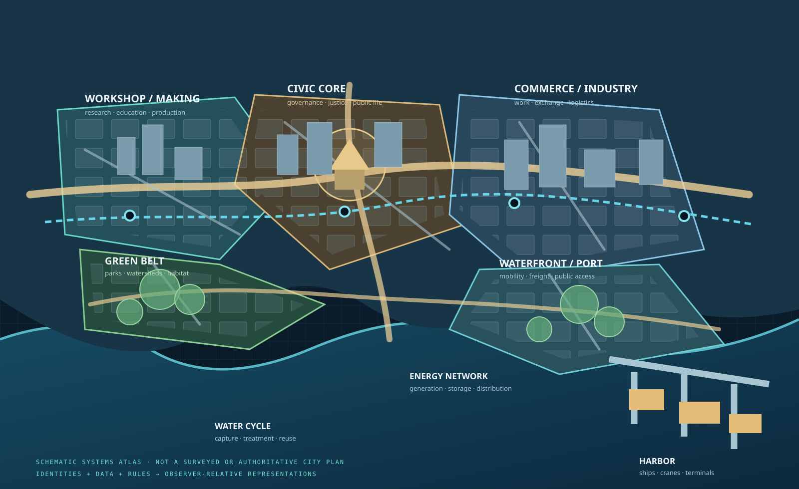

# Civic Quarter — Connected District Proof

This is the first district model that connects multiple city domains through shared stable identities rather than listing unrelated concepts.

## Model

- **Land:** four parcels with explicit land-use classes and parcel-to-building relationships.
- **Buildings:** Civic Hall, Civic Library and Community Clinic; each contains floor-aware room identities.
- **Mobility:** a connected pedestrian/street graph with typed traversal modes and measured-in-fixture edge lengths.
- **Transit:** a shuttle route connecting two stops anchored to mobility nodes.
- **Water:** a distribution source, building service connections and a stormwater outfall with illustrative capacities and flows.
- **Energy:** a substation connected to building and public-space loads, including a critical clinic load.
- **Public realm:** Founders Square with canopy and permeable-surface attributes.
- **Institutions and services:** municipal planning/records and primary care services reference their institutions and physical places.
- **People:** synthetic aggregate population inputs, explicitly not real residents or measured demographics.
- **Scenario:** a tree-canopy intervention with before/after indicators.

## Stable identity and relationship rules

Every entity ID is stable within this model version. Parcel references must resolve to parcels; building references must resolve to parcels; transit stops must resolve to mobility nodes; network edges must resolve to nodes; services must resolve to both an institution and a place. These are validation gates, not merely documentation conventions.

## Living picture

The SVG projection on the City page is generated from this same model. Selecting an entity exposes its ID, connected domain relationships and source record. The district is deliberately a synthetic, internally consistent fixture—not a surveyed geography, utility design, operational transit service, demographic dataset or validated engineering model.

## Scenario interpretation

The canopy scenario changes three displayed values: canopy coverage, illustrative summer surface temperature and a normalized runoff index. It is a causal teaching fixture, not a calibrated urban climate or hydrology prediction. A future Physics/domain integration must replace these illustrative response values with explicitly versioned model outputs and assumptions.

## Reproduce

Run the repository's validation workflow. It checks unique IDs, relationship integrity, connected mobility topology, network edge references, service ownership, scenario arithmetic and the data-driven page projection.
