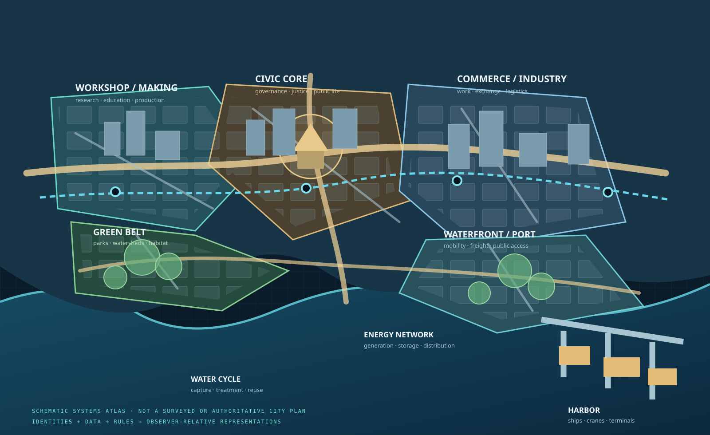

# Civil Systems, Urbanism, and the Living City

**Purpose:** establish Singularity City as a general-purpose, inspectable model of civilization—not merely a procedural building generator. This is a domain map and theory syllabus. It distinguishes established disciplines, useful models, design choices, and future simulation capabilities.

*The atlas is a conceptual systems illustration. It is not a surveyed plan, engineering design, zoning map, or claim that the depicted infrastructure is implemented.*

## 1. The city is a coupled socio-technical-ecological system

A city is simultaneously:
- a **physical artifact**: terrain, parcels, buildings, roads, bridges, pipes, wires, waterways;
- a **social system**: households, communities, institutions, relationships, culture, conflict, cooperation;
- an **economic system**: production, exchange, labor, land value, capital, public goods, externalities;
- a **political system**: authority, representation, law, rights, jurisdiction, accountability;
- an **ecological system**: watersheds, soils, habitat, biodiversity, climate, resource cycles;
- an **information system**: addresses, maps, records, signals, sensors, knowledge, memory;
- a **temporal system**: daily rhythms, seasons, construction, maintenance, migration, growth, decline, recovery.

These systems are coupled. A road changes access and land value; land value changes who can live nearby; land use changes travel demand; travel changes emissions and noise; public policy changes the distribution of benefits and burdens. A model that represents buildings but omits these relationships is a massing model, not a civilization model.

## 2. Domain atlas: what the Workshop should represent

### Geography, geology, and landscape
Terrain elevation, slope, aspect, geology, soils, groundwater, watersheds, floodplains, coastlines, erosion, landslide susceptibility, natural barriers, microclimates, habitat corridors, and land history. Geography constrains construction and routes; infrastructure reshapes geography.

### Architecture and the built environment
Building typology, structure, envelope, materials, floor plates, circulation, accessibility, entrances, daylight, ventilation, fire egress, utilities, adaptive reuse, heritage, construction sequence, deterioration, and maintenance. A building is an addressable hierarchy of site, structure, systems, spaces, components, and occupants—not one mesh.

### Civil and municipal infrastructure
Street hierarchy, intersections, sidewalks, cycleways, bridges, tunnels, rail, stations, ports, airports, freight yards, water supply, stormwater, wastewater, solid waste, district energy, electricity, communications, emergency access, and public realm. Each network has topology, capacity, condition, ownership, service areas, operating rules, failure modes, and dependencies.

### Urban planning and land use
Parcels, zoning, permitted uses, density, floor-area ratio, setbacks, height envelopes, frontage, block permeability, mixed use, transit-oriented development, industrial buffers, public facilities, open space, housing supply, and development phasing. Planning is competing objectives plus enforceable constraints, not a single aesthetic style.

### Transportation and logistics
People and goods move through networks with different modes, capacities, costs, speeds, schedules, accessibility, reliability, and emissions. Model trips as demand plus route choice plus network capacity—not as decorative vehicles moving randomly. Walking, wheeling, cycling, local transit, regional rail, road freight, maritime freight, and future modes are separate capabilities.

### Water, energy, and material metabolism
Cities import, transform, store, distribute, consume, recover, and export resources. Water balances, energy loads, generation, storage, distribution losses, waste streams, recycling, food logistics, and construction materials need units, time periods, boundaries, and provenance. A flow needs a source, sink, capacity, and conservation assumptions.

### Ecology, climate, and environmental quality
Urban heat islands, shade, tree canopy, evapotranspiration, air quality, noise, runoff, permeable surfaces, carbon, habitat fragmentation, biodiversity, coastal resilience, and climate adaptation. Separate measured environmental state, simplified estimates, artistic effects, and physical simulation.

### People, households, and community
Residents are agents with stable identity, household membership, abilities, needs, preferences, relationships, work, education, service access, culture, and time constraints. Avoid reducing people to population-density dots. Aggregates are useful for regional analysis, but identity and privacy boundaries matter.

### Institutions, law, and governance
Municipal departments, elected bodies, courts, public utilities, schools, emergency services, regulators, community organizations, businesses, and informal networks. Each institution has jurisdiction, authority, responsibilities, budget, procedures, records, and accountability. Model rules and decision provenance rather than an omniscient city controller.

### Economy, labor, and public finance
Employment, wages, production, supply chains, household budgets, rent, land markets, taxes, fees, procurement, public investment, debt, grants, business formation, inequality, and externalities. Money flows between actors and institutions; transactions create benefits and costs in different places and times.

### Culture, education, and public life
Libraries, schools, universities, museums, theaters, sports grounds, cultural spaces, festivals, public squares, local media, archives, and informal gathering places. These create knowledge, identity, social connection, and civic capacity; they are not ornamental assets.

### Risk, resilience, and emergency management
Hazards, exposure, vulnerability, critical dependencies, evacuation, shelter, emergency response, redundancy, recovery, insurance, and adaptation. Ask who is exposed, who can respond, which services fail together, and how recovery resources are distributed.

## 3. Civil theory belongs beside computer science

These are intellectual lenses, not universal laws or automatic policy prescriptions.

| Theory / discipline | Core question | City manifestation |
|---|---|---|
| Systems thinking and system dynamics | How do feedback loops create behavior over time? | Housing, traffic, maintenance, resource stocks |
| Network science | How do connectivity and centrality shape access? | Streets, transit, utilities, social networks |
| Urban morphology | How do blocks, plots, streets and building forms evolve? | Figure-ground, frontage, grain, permeability |
| Land economics | How do location, scarcity and regulation shape value? | Rent, land value, development pressure |
| Public choice and institutional economics | How do rules and incentives shape collective decisions? | Budgets, agencies, governance, commons |
| Commons theory | How can shared resources be governed? | Parks, water, fisheries, shared infrastructure |
| Welfare economics | Who benefits, who pays, and what is externalized? | Pollution, congestion, public goods |
| Environmental justice | How are environmental burdens and benefits distributed? | Heat, pollution, green space, hazard exposure |
| Behavioral science | How do people choose under constraints? | Travel, housing, services, public space |
| Sociology and social capital | How do trust, networks and institutions shape outcomes? | Neighborhoods, associations, belonging |
| Political geography | How do boundaries and power organize space? | Jurisdiction, exclusion, access, representation |
| Resilience theory | How do systems absorb disturbance and reorganize? | Cascading failures, adaptation, recovery |
| Ecological economics | What are the biophysical limits of economic activity? | Energy, materials, water, waste, habitat |
| Life-cycle assessment | What impacts occur across a system's full life? | Buildings, transport, materials, infrastructure |
| Real-options reasoning | What is the value of preserving future choices? | Phasing, adaptable buildings, reserve capacity |

A theory page should expose assumptions, variables, causal diagrams, competing interpretations, empirical limits, and an interactive experiment. Contested political or ethical questions must not be flattened into a fake objective score.

## 4. Model the city as linked, typed networks

One graph is not enough. Maintain distinct but connectable networks:
- **spatial containment:** city → district → block → parcel → structure → floor → space;
- **physical connectivity:** road, path, rail, pipe, cable, channel;
- **traversal:** actor- and mode-specific feasible movement;
- **service coverage:** which populations and places can reach a service;
- **ownership and control:** title, lease, easement, operator, jurisdiction;
- **social relations:** household, affiliation, organization, trust, care;
- **economic flows:** supplier, producer, worker, customer, taxpayer, beneficiary;
- **ecological relations:** habitat, watershed, food web, material and energy flow;
- **causal history:** event, decision, action, consequence, affected entity.

Each edge needs a relationship type and, where appropriate, direction, capacity, cost, validity interval, permissions, confidence, and provenance. Geographic adjacency is not the same as legal access, visibility, or traversability.

## 5. Time is a first-class dimension

City state changes at different cadences:
- sub-second: movement, collision, signal phase, vehicle control;
- seconds/minutes: pedestrian flow, queueing, dispatch, local operations;
- hours: work shifts, school schedules, service demand, deliveries;
- days/weeks: maintenance, markets, events, construction stages;
- seasons/years: weather regimes, budgets, migration, development, ecological succession;
- decades/centuries: infrastructure renewal, demographic transition, climate change, urban morphology.

Do not simulate every resident and every pipe at frame rate. Authoritative state, event history, aggregate models, and observer-relative presentation can operate at different cadences. Lower-fidelity distant models must preserve meaningful totals and causal transitions.

## 6. Evidence, uncertainty, and ethical boundaries

Every important value should identify whether it is:
1. observed or measured;
2. sourced from a published dataset;
3. derived by a documented calculation;
4. estimated by a model;
5. authored as a design choice;
6. illustrative or fictional.

Record units, coordinate reference, time period, spatial resolution, source date, uncertainty, assumptions, and transformations. Do not present illustrative city metrics as empirical evidence.

Human data requires care: data minimization, purpose limitation, access control, aggregation, retention, and separation between public urban statistics and private resident records. A city simulation is not permission to expose personal lives.

## 7. The visual proof ladder

The living picture should make increasing levels of truth visible:

1. **Atlas illustration:** explains the system; not executable or authoritative.
2. **Data-driven plan:** geometry is generated from typed source data.
3. **Inspectable model:** select a parcel, road, building, service or network and inspect provenance.
4. **Analytical layer:** compute a defined measure such as route accessibility, service coverage or water balance.
5. **Deterministic scenario:** change an input, run a bounded model, compare before and after.
6. **Authoritative simulation:** domain owner advances state and records events.
7. **Observer-relative manifestation:** Renderer chooses representation; Visualize manifests the frame.
8. **Persistent shared world:** host persists, synchronizes, authorizes and recovers state.

Never label an earlier rung as a later one. The current City map and generated parcels are an early data-driven authoring preview; Visualize has a separate deterministic CPU/SVG city-massing proof. The cross-repository handoff defines how these should converge without City copying rendering logic.

## 8. Reusable capability families

Start with domain contracts and executable proofs; do not create one package for every noun. Potential capability families:
- Geography, parcels, zoning, buildings;
- streets, transit, freight, navigation;
- water, energy, waste, communications;
- environment, ecology, hazards;
- residents, households, institutions;
- economy, public finance, governance;
- culture, education, public space;
- analytics, scenarios, provenance.

Split a capability into its own package only when it has an independent contract, lifecycle, dependency closure, consumer, or release cadence.

## 9. Next city proof: one complete systems district

Build a district with parcel and building hierarchy; street and pedestrian network; transit stop and route; water supply and stormwater path; electricity distribution and a visible public facility; park/tree-canopy layer; a small synthetic population and service schedule; and a civic decision that changes modeled outcomes.

The visitor should select a place, inspect data and assumptions, change a scenario input, and see map and measurements respond. Entity IDs must persist through map, analytical overlay, Renderer frame, and Visualize output.

## 10. Research references to seed the theory library

Use authoritative and primary sources when building individual lessons. Candidate source families:
- UN-Habitat and UN statistical publications for urbanization and settlement indicators;
- World Bank urban development and infrastructure research;
- OECD regional, metropolitan and public-governance work;
- IPCC assessment reports for climate risk and adaptation;
- FEMA and national civil-protection agencies for hazard planning;
- national transport and public-works agencies for engineering standards;
- academic urban morphology, planning, economics, sociology, ecology and systems journals;
- local comprehensive plans, capital improvement plans, zoning codes, environmental impact statements and infrastructure master plans.

Each lesson should cite a specific edition, chapter, page or dataset version. A source-family link is a research starting point, not evidence for a numeric claim.

---

*The goal is not to make a city look plausible from one camera angle. It is to make the relationships that create a city understandable, inspectable, and eventually executable.*
