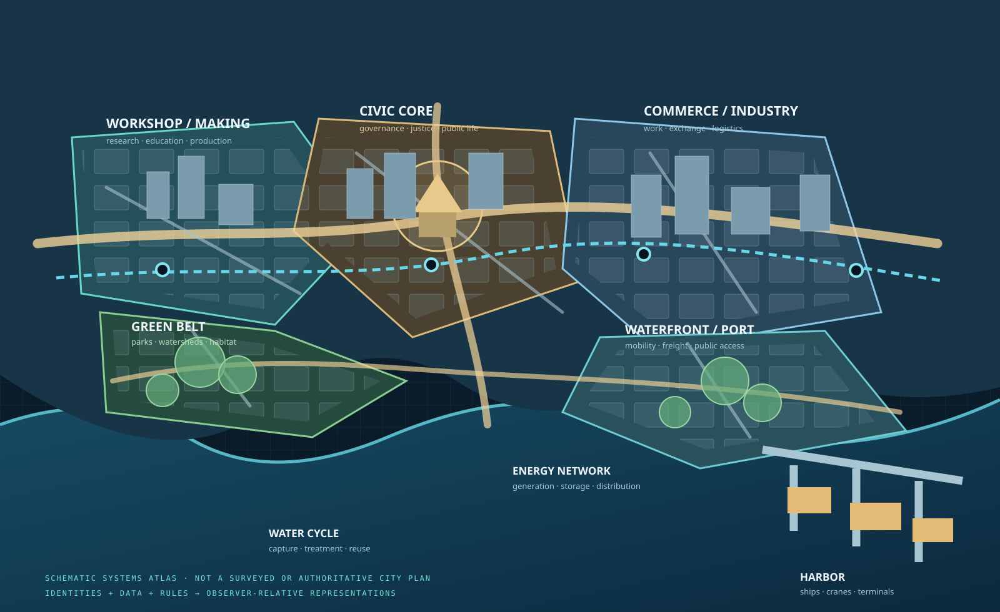

# Living Picture — City as an Observable World

**A living picture is not an animated poster.** It is a visible projection of a world model whose entities, relationships, rules, and changes can be inspected.

## One world, several views

The same city must be addressable as:
- **Regional / city plan:** coastline, terrain, districts, major routes, watersheds, transit and activity aggregates.
- **District / aerial:** blocks, parcels, building footprints, parks, stops, utilities and service coverage.
- **Street:** façades, entrances, sidewalks, crossings, trees, vehicles, Digitens and public life.
- **Building / interior:** floors, rooms, circulation, systems, furnishings, occupants and access.
- **Infrastructure:** network topology, capacity, condition, flows, dependencies and failures.
- **Analytical:** accessibility, density, land use, heat, water balance, travel demand, service equity and economic flows.
- **Historical / temporal:** construction, maintenance, policy changes, events, seasonal cycles and long-term transformation.

A view is an observer and a representation policy, not a separate world or a new set of entity identities.

## Rendering ownership

Singularity City owns authored domain facts and stable spatial identity. It does not duplicate rendering policy or image manifestation.

- **City / Experience:** what exists, where it exists, its domain state, source revision and spatial meaning.
- **Renderer:** which representation and computational work are justified for a given observer, intent, visibility and budget.
- **Visualize:** consumes the selected frame and manifests image output through a backend.
- **Host / WebPage:** camera, navigation, selection, interaction, persistence, authorization and presentation lifecycle.
- **Physics and domain capabilities:** authoritative physical consequences and domain-specific simulation.

The existing cross-repository coordination contract is [Singularity City Rendering Handoff](https://github.com/TrentBest/TheSingularityWorkshop.Visualize/blob/development/docs/integrations/SINGULARITY_CITY_RENDERING_HANDOFF.md). It explicitly stages plan view, district/aerial, street, building/interior and vehicle views while preserving identity.

## Existing proof and next integration

Visualize already has a deterministic City Massing proof. It generates a procedural street lattice, varied building heights, façade strips and landmarks, then follows:

**scene data → Renderer representation policy → Renderer frame adapter → VisualizerFrame → Visualize SVG backend → generated artifacts**

That is a CPU-side SVG proof, not a GPU renderer, calibrated urban model, persistent city or live street-level world. See the [City Massing sample](https://github.com/TrentBest/TheSingularityWorkshop.Visualize/tree/development/samples/CityMassing) and [Visualize gallery](https://github.com/TrentBest/TheSingularityWorkshop.Visualize/blob/development/docs/GALLERY.md).

The City browser currently has a separate declarative district/route/parcel preview. It now also embeds Visualize's WebGPU Soldier Field proving ground, whose workload cadence is driven by a generated Renderer policy manifest. That lab is a capability demonstration, not yet a rendering of City geometry. The district preview and Renderer/Visualize pipeline must converge through explicit world inputs and stable IDs—not by copying a second renderer into City.

## The visual proof contract

Every visual page or artifact should state:
1. **What is shown:** entities, fields, relationships and scope.
2. **Where the data comes from:** source file, repository, dataset, algorithm and revision.
3. **What is computed:** deterministic generation, analysis, simulation or rendering.
4. **What is illustrative:** artistic choices, synthetic values and placeholders.
5. **What is not implemented:** persistence, physical simulation, GPU execution, interaction or authority not actually present.
6. **How to reproduce it:** command, workflow, seed, inputs and expected artifact.

The current atlas illustration is intentionally a systems concept image. It helps visitors see the breadth of the domain, but does not pretend to be generated from authoritative city state.

## Ambient SVG layers and inhabited places

The first ambient SVG study puts the idea into a concrete scene: a river with flowing highlights, a connected road, tiny travelers, a peddler with a handcart, a market keeper, customers, an inn, and a mill. The motion is deliberately presentation-only. It does not advance a clock, move authoritative residents, settle purchases, or run pathfinding.

The next map renderer should assemble these effects from semantic layers rather than bake the whole world into one illustration:

- **Terrain and hydrology:** ground, shorelines, streams, rivers, waterfalls, seasonal overlays.
- **Transport:** roads, paths, bridges, routes, traffic and tiny traveler actors.
- **Places:** settlements, buildings, shops, inns, homes, public spaces and entrances.
- **Ambient life:** residents, visitors, shopkeepers, customers, wildlife, lights, smoke, flags and vegetation.
- **Observation:** labels, selection outlines, provenance, visibility and level-of-detail transitions.

Every visual actor should eventually bind to a stable domain identity when one exists. A shopkeeper is a City resident assigned to a place/role; a customer is a visitor or resident with a visit relationship; a traveler is an actor moving along a declared route. Decorative placeholders must remain visibly distinguishable from data-backed actors.

Nested maps should preserve identity and spatial transforms while changing detail: world → region → settlement → district → site/building → interior/room. A parent view composes child map surfaces; it does not duplicate their domain records. Renderer selects the appropriate representation and LOD; Visualize manifests it; City remains the authority for City-owned geography, place relationships, residents and visits; Physics and other domain owners supply their own authoritative consequences.

SVG animation must honor `prefers-reduced-motion`, remain understandable as a static image, and never be used as proof that a simulated event occurred.

## From image to instrument

The next substantive vertical slice should be one district with a connected, inspectable system:
- parcel → building → room identity hierarchy;
- street and pedestrian graph with traversability;
- transit route, stop, schedule and capacity;
- water supply, stormwater catchment and treatment path;
- electricity source, distribution and loads;
- public space, tree canopy and environmental observations;
- synthetic households, workplaces and civic services;
- a policy or infrastructure scenario with before/after results.

A visitor should be able to select a building, follow its service dependencies, inspect assumptions, change one scenario input, and see both the picture and the analytical outputs respond. Renderer then chooses the appropriate representation of those same identities; Visualize manifests the resulting frame.

## Theory must be visible

The city should teach its own domain. Pair the visual layers with causal diagrams, maps, time series, network views, section cuts, flow diagrams and scenario controls. Explain civil engineering and urban theory beside the picture, not in an isolated wall of prose.

Start with [Civil Systems and City Theory](CIVIL_SYSTEMS_AND_CITY_THEORY.md), then expand each discipline into source-grounded lessons and executable experiments.

## First identity-bound map actor

The [Greenhollow living-scene manifest](GREENHOLLOW_LIVING_SCENE.md) now accompanies the ambient SVG. It binds the peddler's visual actor to the existing `mara-peddler` fixture identity while explicitly keeping the keeper, customers, second traveler, and map geometry illustrative. The manifest is validated in the Pages build. This is an identity-binding proof, not simulated movement or authoritative map geometry.
