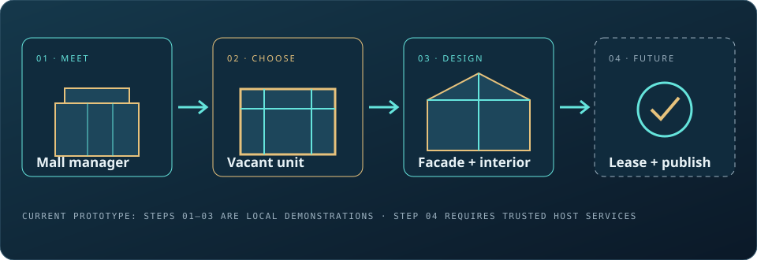

# Singularity Mall Management, Leasing and Tenant Design

**Status: interactive local design prototype.** This document separates the current browser demonstration from future leasing, tenant administration and shared-world services.

## The mall management office

The mall now includes a dedicated City-owned management-office space. It is the natural public point of contact for leasing enquiries, tenant orientation, building operations and public-area coordination. The page presents a scripted manager conversation so visitors can explore the intended interaction without pretending that a live employee or AI agent is connected.

The manager role is deliberately not assigned a new character schema. Its future identity must use the shared SURPS character/agent contract. Until then, the fixture identifies only the office and role.

## Vacant units and leasing boundary

`data/mall-leasing.json` defines three explicitly vacant demonstration units. Each unit has a stable ID, a containing City zone, a conceptual floor area, frontage and clear interior dimensions. These are authored design fixtures, not live availability, surveyed dimensions, lease terms or a binding offer.

City owns the mall, spatial unit identity, public access and the leaseable location. Economy owns merchant accounts, catalogues, pricing, inventory, transactions and settlement. SURPS owns shared character identity and roleplaying contracts. FSM_COS / the trusted host owns authentication, authorization, sessions and persistence.

A future lease should be a versioned record that binds a tenant identity to a precise City unit and term, with delegated administrators, permitted uses, access policy, service/resource allowances, audit history, renewal and termination. Merely seeing a vacant unit must not grant access or ownership.

## Facade and interior design

The browser workbench allows a visitor to select a vacant fixture, name a proposed store, edit sign text and choose a facade palette. It also previews two distinct interior policies:

- **Shell constrained:** the proposed interior is drawn inside the unit's authored clear dimensions.
- **Freeform interior:** the creator can explore a larger unconstrained conceptual interior. The exterior unit identity and leased frontage remain fixed.

Freeform is a creative freedom, not a waiver of structural, fire/life-safety, accessibility, utility, egress or building requirements. Even constrained mode uses conceptual dimensions, not verified architectural measurements.

Drafts are saved only in the current browser profile and can be exported as JSON. They are not visible to another visitor and do not create a tenant account, submit an application, reserve a unit, grant a lease or publish a storefront.

## Current interaction

1. Open the management office and choose a scripted question.
2. Select one of the authored vacant unit fixtures.
3. Customize the storefront name, sign and palette.
4. Switch between shell-constrained and freeform interior previews.
5. Save a local draft or export it for inspection.

The lifecycle illustration shows where the future trusted-host lease and publication step belongs.

## Shared-world reality check

GitHub Pages publishes the same static City and Mall definitions to every visitor. Each browser renders its own instance. Browser-local drafts and proof-review checkboxes are private to that browser profile and origin. There is no shared live occupancy, tenant ownership, avatar presence, chat, lease application, synchronized design editing or authoritative persistence in this prototype.

A live mall requires a trusted host (the ServerApp direction) to authenticate participants, authorize tenant roles, own the authoritative lease and unit state, coordinate sessions/presence, persist tenant designs, and publish versioned state to clients. SURPS should supply shared character/agent semantics; City should retain authority over the physical and civic place graph. A browser client must never be allowed to self-assert ownership by editing local data.

## Next gates

1. Bind the manager role to SURPS's adopted character/agent contract.
2. Define a versioned City leaseable-unit and lease record, including unit lifecycle and conflict rules.
3. Define tenant organization, owner, administrator, employee and guest authorization through the trusted host.
4. Persist tenant facade/interior manifests with immutable revisions, moderation, validation and rollback.
5. Connect tenant merchant identity to Economy without duplicating catalogues or settlement.
6. Add spatially anchored shared presence only after authenticated multi-session synchronization exists.
7. Replace the illustrative SVG and floor-plan fixtures with a measured, physically grounded scene pipeline; retain provenance, units, uncertainty and explicit quality gates.

## Evidence and limitations

The page is a local design prototype. It demonstrates the shape of the management and tenant workflow, not a production mall operation. Vacancies, dimensions, prices, lease terms, staff schedules, code compliance and accessibility are not asserted as real-world facts.
