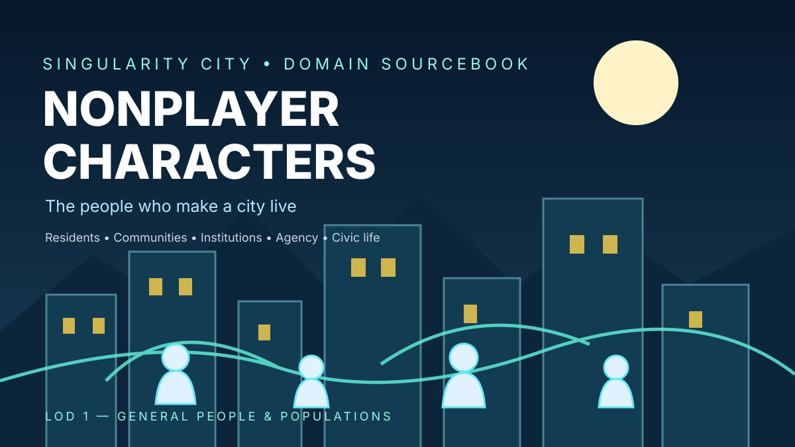

# Singularity City — Source Books

Singularity City sourcebooks describe the inhabited world: people, places, institutions, civic systems, and the relationships that make a persistent city function.

## Domain books

### Nonplayer Characters — LOD 1

Descriptor: [nonplayer-characters.book.json](nonplayer-characters.book.json)

The general people-and-agency domain for residents (Digitens), visitors, communities, occupations, institutions, civic roles, daily life, population fidelity, relationships, and behavior.

[Read Nonplayer Characters](nonplayer-characters.md)

Higher-detail domain books specialize this shared model without redefining the person or resident.
