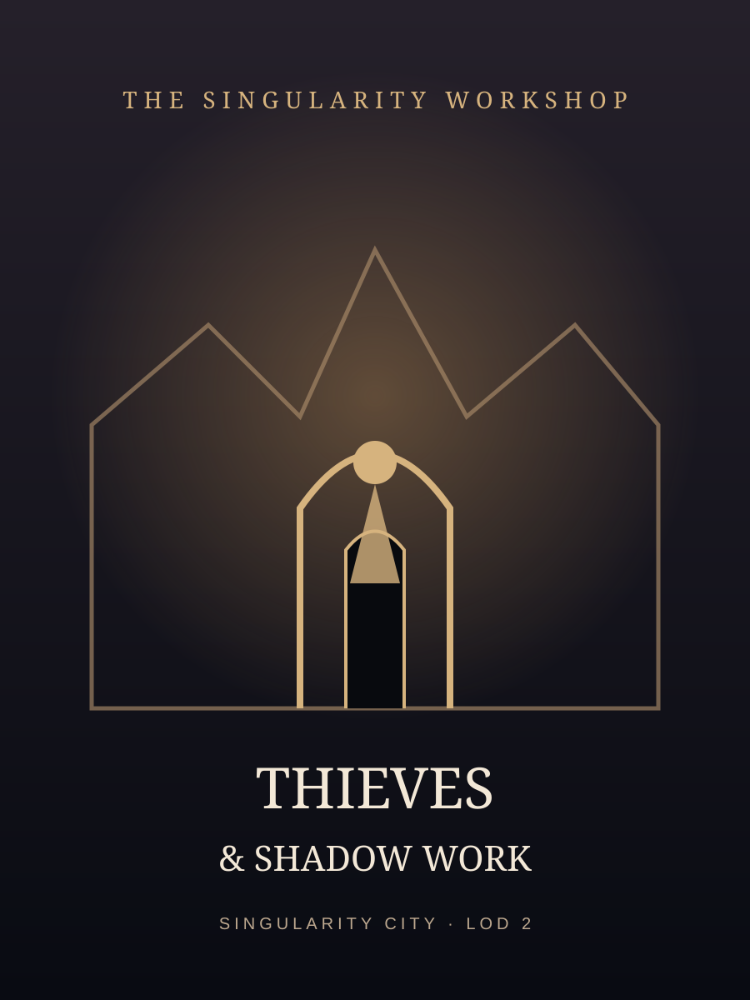
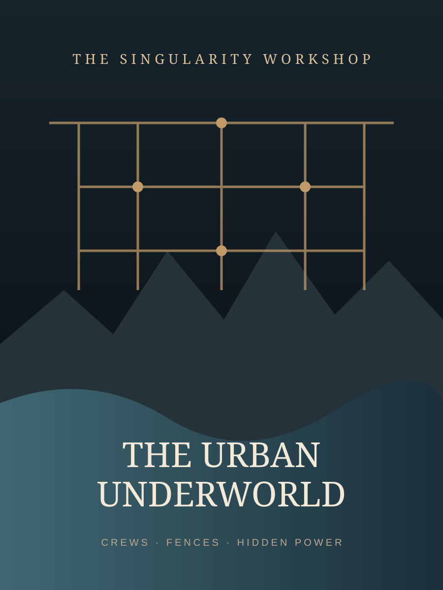

# Singularity City — Source Books

Singularity City sourcebooks describe the inhabited world: people, places, institutions, civic systems, and the relationships that make a persistent city function.

## Domain books

### Nonplayer Characters — LOD 1

Descriptor: [nonplayer-characters.book.json](nonplayer-characters.book.json)

The general people-and-agency domain for residents (Digitens), visitors, communities, occupations, institutions, civic roles, daily life, population fidelity, relationships, and behavior.

[Read Nonplayer Characters](nonplayer-characters.md)

Higher-detail domain books specialize this shared model without redefining the person or resident.

### Vehicles, Mobility and Transport

[Read Vehicles, Mobility and Transport Systems](vehicles.md) — vehicle definitions and instances, capability profiles, journeys, fleets, route compatibility, and Economy/Physics boundaries.

### Buildings, Materials and Construction

[Read Buildings, Materials and Construction](buildings-and-construction.md) — material availability, fabrication, tools, skills, construction dependencies, feasibility and civic lifecycle.

### City Economy

[Read Economy in Singularity City](../ECONOMY_IN_SINGULARITY_CITY.md) — shared Economy package integration, non-redeemable City Marks and the deterministic Civic Quarter market-day scenario.

### Thieves & Shadow Work — LOD 2

Descriptor: [thieves-and-shadow-work.book.json](thieves-and-shadow-work.book.json)

[Read Thieves & Shadow Work](thieves-and-shadow-work.md) — thief character roles, motives, agency, relationships, allegations, incidents, victim impact, reform and the shared Economy boundary. Specializes the LOD 1 people model.

### The Urban Underworld — LOD 2

Descriptor: [urban-underworld.book.json](urban-underworld.book.json)

[Read The Urban Underworld](urban-underworld.md) — crews, guilds, fences, disputed property, black markets, informal networks, corruption, rumor and the hidden power relationships of a city.

## Place books

A separate editorial track covers individual settlements, cities, archaeological sites and cultural landscapes rather than reusable domain concepts. The shared reference ontology determines reality membership; City does not invent a local real/fiction taxonomy. An evidence-based reconstruction of a real site's past is distinguished from direct observation, while an alternate-history or invented version belongs to a fictional reality. Fictional places can retain a **based on** relationship to real inspirations without being presented as real locations. See [Reality Sets, Place Identity and Historical Reconstruction](../REALITY_AND_RECONSTRUCTION.md).

[Read the City Sourcebooks program](../CITY_SOURCEBOOKS.md) for the evidence standard, archaeological interpretation safeguards, time-slice convention, educational direction, folder structure, LOD guidance and candidate catalogue.

**First research pilot:** [Göbekli Tepe](places/gobekli-tepe/README.md) — a source-checked research plan for a scan-first present-day visit and evidence-based historical reconstruction. It does not yet contain acquired scans or a completed reconstruction.

**Other proposed research candidates:** Tacoma, Tenochtitlan, Troy / Hisarlık, Uruk, Çatalhöyük, Mohenjo-daro, Teotihuacan, Cahokia, Great Zimbabwe, Angkor, Pompeii, New York City, Tokyo, Venice, London, Rome and Singapore. These remain editorial candidates, not completed or researched books.

Each place book must distinguish sourced evidence, source interpretations, derived analysis, authored reconstruction, scenarios and unknown/disputed claims. Archaeological reconstructions must expose uncertainty instead of presenting a single attractive image as settled history.

## Cross-domain example: dwarves in a market

A town may host dwarven merchants, customers, travelers, and visitors because they are part of its resident/visitor population. City owns those people-to-place relationships and market activity. SURPS [Dwarves, LOD 1](https://github.com/TrentBest/TheSingularityWorkshop.SingularityUniversalRolePlayingSystem/blob/development/docs/books/dwarves.md) supplies the cultural and encounter context. A nearby stronghold can remain a known but unopened destination; entering it escalates to [Dwarven Strongholds, LOD 2](https://github.com/TrentBest/TheSingularityWorkshop.SingularityUniversalRolePlayingSystem/blob/development/docs/books/dwarven-mountain-fortress.md), with FSM_Dungeon owning its spatial topology.
