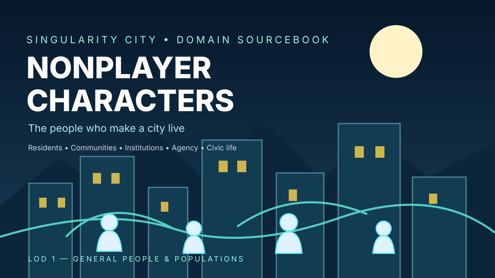

# Nonplayer Characters — the people who make a city live

**Owner:** Singularity City · **LOD:** 1 · **Status:** Domain sourcebook and design contract, not a claim of a complete NPC simulator.

A city is not populated by scenery. It is made of people who live somewhere, go somewhere, know some things, need some things, form relationships, make decisions, perform work, and change the place around them. This book defines the general NPC and resident domain for Singularity City: from a villager, peddler, and baker to a city official, transit operator, visiting researcher, or citizen of a vast science-fiction metropolis.

In City, the persistent inhabitant concept is a **Digiten** (resident). **NPC** describes a play/control relationship: a character is not directly controlled by a player at the current moment. It does not describe worth, agency, intelligence, or personhood. A Digiten may be player-controlled, host-operated, autonomous, simulated at an aggregate level, or temporarily represented as an individual.

## 1. Domain ownership

City owns resident and visitor relationships, city-level identity references, home/work/current location, schedules and activities, communities, families, affiliations, occupations, civic positions, population representation, and relationships between people, institutions, places, and events.

City does not own every specialist capability a person may use. Laboratories own laboratory operations; Physics owns physical models; specialist domains own their internal procedures; trusted hosts own authentication, digital authorization, and enforcement. City connects people to these domains without absorbing their authority.

## 2. Character, resident, visitor, and NPC

| Concept | Meaning |
|---|---|
| Person / character | A continuing individual in the represented world |
| Resident / Digiten | A character with a persistent relationship to a City or settlement |
| Visitor | A character present without being a resident |
| NPC | A character not directly player-controlled at the current moment |
| Player character | A character whose decisions are currently directed by a player |
| Population cohort | A group represented collectively when individual detail is unnecessary |
| Institution | An enduring organization with members, responsibilities, resources, and history |

Control can change without changing identity. An NPC can become a player character; a player character can return to host control; a visitor can become a resident. A character may be synthetic, robotic, alien, fantastical, or nonhuman where the setting supports it.

## 3. Character profile

Build profiles from separable facets; use only the detail the scenario needs.

### Identity and continuity
Stable character identity, names and aliases, origin, culture or lineage, life stage where relevant, appearance, current status, known locations, continuity, public/private/disputed facts, and provenance. Identity must not be derived from display name, location, occupation, or host account.

### Capabilities and limitations
Skills, aptitudes, practiced abilities, equipment actually available, qualifications and their validity, accommodations, current condition, fatigue, injury, and confidence/evidence. A claimed capability is not necessarily a demonstrated one.

### Knowledge and belief
What the character knows, suspects, misunderstands, remembers, has forgotten, or has never encountered. Knowledge has a source, time, context, and confidence. Stored world truth is not automatically character knowledge; player-facing presentation must respect what the character has learned.

### Needs, motives, and goals
Physical, social, economic, cultural, professional, and personal needs; short-term tasks; long-term ambitions; competing obligations; fears and values; and circumstances that could change a decision. Avoid reducing a character to one alignment score or quest-giving function.

### Relationships and affiliation
Family, friendship, rivalry, mentorship, partnership, dependency, employment, membership, citizenship, factional ties, reputation, trust, debts, and obligations. Relationships may be asymmetric.

## 4. Agency and everyday life

A useful conceptual behavior cycle is **Perception → Interpretation → Motivation → Deliberation → Decision → Action → Consequence → Learning**. This is a domain model, not a requirement that every NPC run a sophisticated AI planner. Simulation fidelity should match character importance, observer relevance, and compute budget.

A character may be unable, unwilling, unaware, interrupted, distracted, exhausted, misinformed, or prohibited from acting. Distinguish these outcomes. Everyday examples include a baker preparing and serving customers, a peddler traveling between settlements, a guard patrolling and resting, a mayor attending civic business, or a student studying and socializing. Schedules are plans, not guarantees: emergencies, weather, fatigue, route disruption, and personal choices can change them. People do not teleport to satisfy a schedule.

## 5. Institutions, occupations, and positions

A city contains government, emergency response, education, healthcare, transit, utilities, maintenance, trade, hospitality, cultural organizations, guilds, clubs, and informal communities.

| Concept | Meaning | Example |
|---|---|---|
| Capability | What a character can do | Operate a tram |
| Qualification | Evidence of meeting a standard | Current operator qualification |
| Occupation | Broad kind of work | Transit operator |
| Position | A defined place an institution needs filled | Evening Route 4 operator |
| Role | Responsibilities in context | Operate service and report incidents |
| Assignment | Time-bounded placement into a position or duty | Assigned to Route 4 tonight |
| Membership | Belonging to an institution or group | Transit department member |
| Authority | Recognized decision right | Dispatch supervisor may reroute service |
| Authorization | Trusted system permission for a digital action | Host permits dispatch-console access |

A position can be vacant; one person can have multiple assignments; a person can be qualified but unassigned or assigned but off duty. Job title does not grant legal authority or digital access. Institutions declare purpose, responsibilities, positions, required competencies, staffing capacity, service coverage, hours, resources, and accountability. City owns civic institution context; specialist domains own their internal operations.

## 6. Population representation and fidelity

Use levels appropriate to relevance and compute:
1. **Aggregate population** — counts and distributions for regional planning.
2. **Cohort** — groups such as commuters or market visitors.
3. **Named background character** — persistent identity and relationships, limited active behavior.
4. **Foreground character** — detailed knowledge, motives, dialogue, activity, and interaction.
5. **Player-associated character** — foreground character with explicit player or shared control.

Promotion/demotion must preserve stable identity and important causal history. Aggregation must not silently erase named characters, promises, debts, relationships, or unresolved events. Disclose approximation.

## 7. Places, routes, economy, and events

People are spatial participants. Homes, workplaces, destinations, routes, and positions connect to City geography. Movement depends on routes, access, mobility, transport, time, and conditions. Visibility, perception, adjacency, and traversability are distinct.

Economic activity connects people to shops, services, employment, inventory, production, supply, demand, and currency. City may represent a peddler offering goods; the owning economy domain defines exchange semantics. Important changes should be events with actor, time, cause, affected entities, and provenance: moving residence, accepting a position, opening a shop, joining an institution, missing a shift, witnessing an incident, or leaving the city.

## 8. Dialogue and information

Dialogue is interaction between characters with different knowledge, goals, relationships, and perspectives. Responses depend on what the speaker knows, believes the listener knows, motives, communication ability, and context. Messages may be delayed, misunderstood, intercepted, forged, or never received. GrammarAi and ProtocolAi may assist language handling; they do not become the authority for identity or world truth.

## 9. Tabletop use

A compact NPC record needs identity/current situation, immediate goal, knowledge and misunderstandings, capabilities and limits, important relationships, current location/schedule/resources, and what could change the character's decision. A game master may resolve background activity with one event, a schedule, a reaction roll, or a full scene. Do not require minute-by-minute simulation of every resident.

## 10. Safety and trust boundaries

Do not use disability, culture, identity, or life circumstances as shortcuts for moral worth or competence. Fictional role and dialogue never establish real digital authority. Authentication, credentials, permission checks, secret storage, and enforcement belong to trusted host systems; a client-side label is never authorization.

## 11. Cross-domain ownership and higher LOD

| Concern | Owner |
|---|---|
| General character, resident, and NPC domain | Singularity City |
| City institutions, civic positions, schedules, resident-place relationships | Singularity City |
| Laboratory staff roles and operational duties | Singularity Laboratories |
| Scientific models and physical processes | Physics |
| Language and protocol capabilities | GrammarAi / ProtocolAi |
| Authentication, authorization, enforcement | Trusted host / security platform |
| Tabletop procedures and campaign composition | SURPS |
| Rendering and visual manifestation | Renderer / Visualize |

[Laboratory NPCs — LOD 2](https://github.com/TrentBest/TheSingularityWorkshop.SingularityLaboratories/blob/development/docs/books/laboratory-npcs.md) specializes this model for laboratory positions, qualifications, staff responsibilities, participants, shift coverage, safety governance, and examples. It extends general character identity; it does not define a second kind of person.

## 12. Implementation boundary and validation

This is a domain and authoring contract, not a claim of a complete persistent NPC engine, autonomous behavior runtime, population simulator, dialogue service, or staffing scheduler. City currently documents resident concepts and synthetic population fixtures; those are not proof of a production resident system.

Validate against: (1) a village with families, shopkeeper, peddler, mayor, and part-time guard; (2) a dense science-fiction city with huge population and multiple fidelity levels; (3) a resident who changes jobs and becomes player-controlled without losing identity; and (4) an institution whose staffing changes while historical events and digital authorization remain separate.
